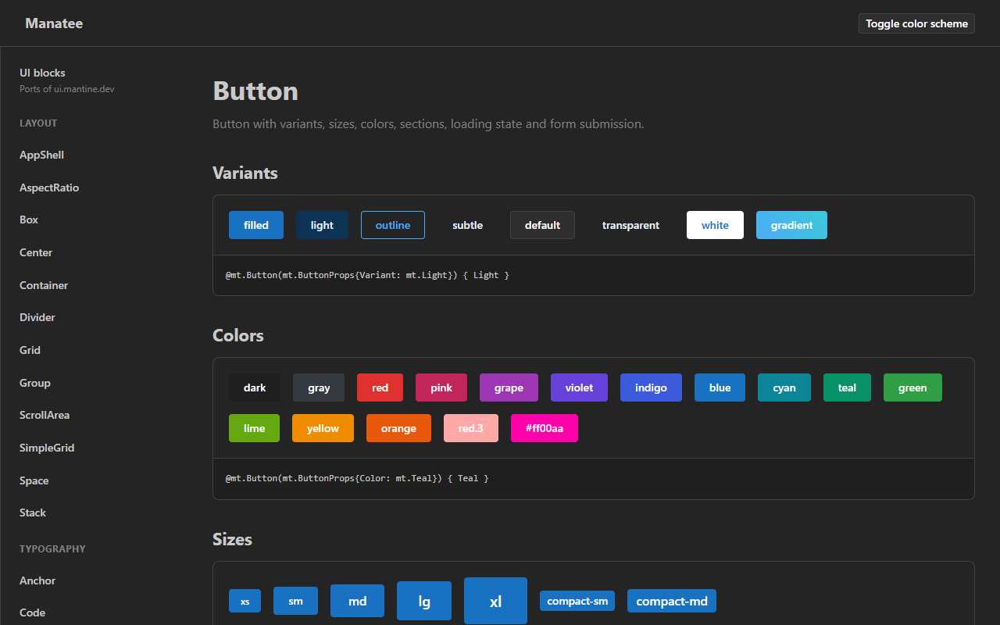
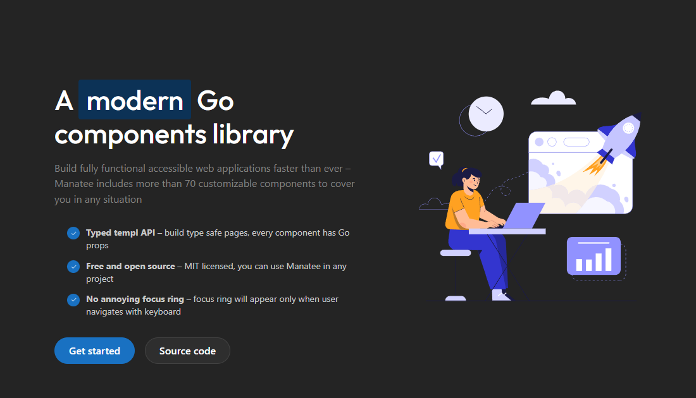
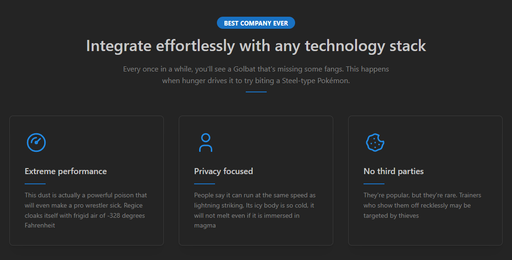
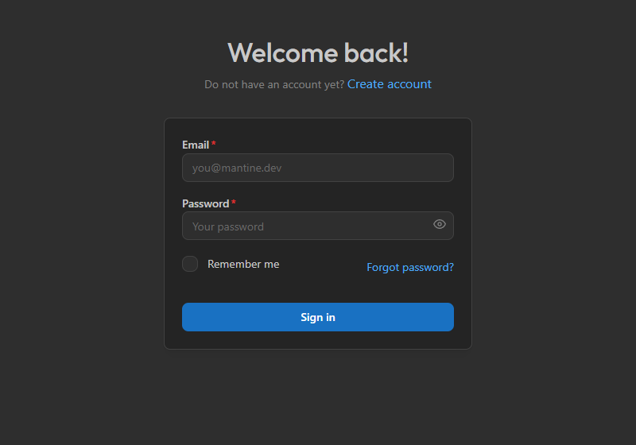
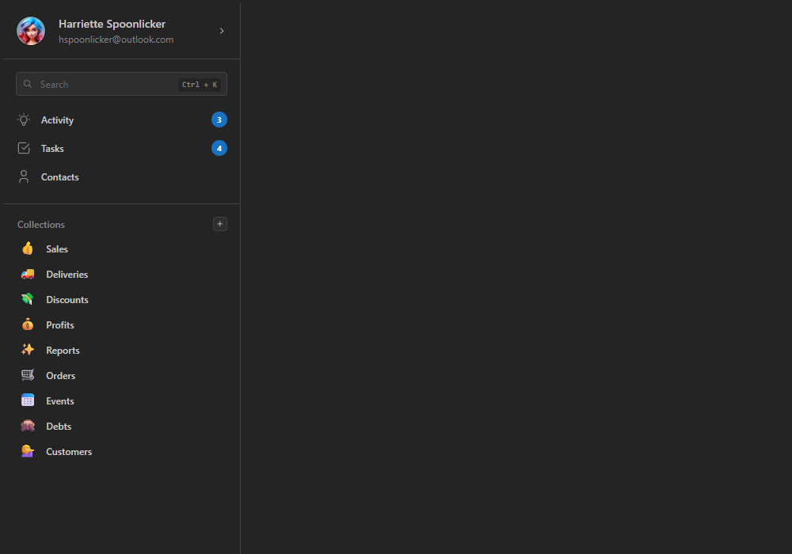
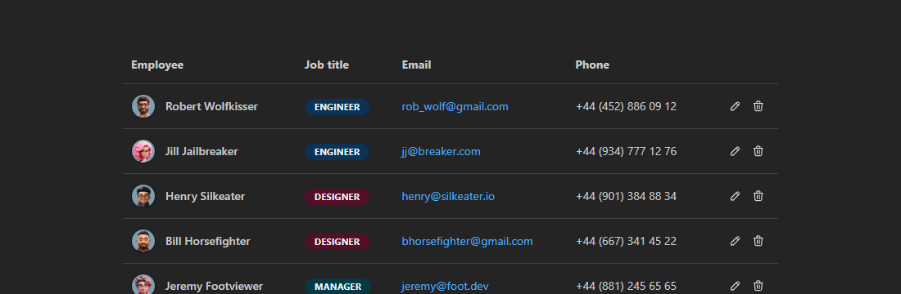
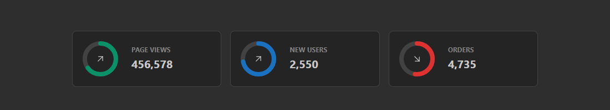

<p align="center">
  
</p>

# Manatee

[](https://github.com/LiamFromVictoria/Manatee/actions/workflows/ci.yml)

Mantine-style UI components for Go web apps, built as zero-dependency web components.

- **`<mt-*>` custom elements**: vanilla Shadow DOM, about 1 base class, no runtime deps.
  They work with plain HTML, HTMX swaps, and any server.
- **Typed templ API**: `@mt.Button(mt.ButtonProps{Variant: mt.Light, Color: mt.Teal}) { Save }`.
- **Mantine theme**: the same palette, spacing, radius, shadows, sizes and variants,
  exposed as CSS custom properties (`--mt-*`), with light/dark color schemes.
- **Native forms**: inputs are form-associated (`ElementInternals`), so they submit,
  validate and reset with a plain `<form>`.
- **No Node required**: esbuild runs through its Go API, and the bundle is embedded with `go:embed`.

## Quick start

```sh
go get github.com/LiamFromVictoria/Manatee@latest
```

```go
package main

import (
    "net/http"

    "github.com/a-h/templ"
    "github.com/LiamFromVictoria/Manatee"
)

func main() {
    mux := http.NewServeMux()
    mux.Handle(manatee.Prefix, manatee.Handler()) // serves /_manatee/manatee.{js,css}
    mux.Handle("/", templ.Handler(Page()))
    http.ListenAndServe(":8080", mux)
}
```

```templ
package main

import "github.com/LiamFromVictoria/Manatee/mt"

templ Page() {
    <html>
        <head>
            @mt.Head(mt.HeadProps{})
        </head>
        <body>
            <form method="post" action="/subscribe">
                @mt.Stack(mt.StackProps{Gap: mt.MD}) {
                    @mt.TextInput(mt.TextInputProps{Name: "email", Label: "Email", Required: true})
                    @mt.Button(mt.ButtonProps{Type: "submit"}) {
                        Subscribe
                    }
                }
            </form>
        </body>
    </html>
}
```

Without templ, write the elements directly:

```html
<mt-button variant="light" color="teal" size="md">Save</mt-button>
```

### Props conventions

| Mantine (React) | HTML attribute | Go field |
|---|---|---|
| `variant="light"` | `variant="light"` | `Variant: mt.Light` |
| `withBorder` | `with-border` | `WithBorder: true` |
| `title` | `heading` | `Title` |
| `mt="md"` (style props) | `mt="md"` | `Base: mt.Base{Mt: mt.MD}` |
| `fz="sm"` / `lh={1}` | `fz="sm"` / `lh="1"` | `Base: mt.Base{Fz: mt.SM, Lh: "1"}` |
| `leftSection={<Icon/>}` | `<span slot="left-section">` | `LeftSection: templ.Component` |
| `onChange` | `change` event (detail carries the value) | n/a |

Extra attributes such as `hx-*`, `data-*` and `aria-*` go through `Base{Attrs: templ.Attributes{...}}`.

### Color scheme

`mt.Head` applies the stored preference before paint. From JS, call
`manatee.setColorScheme('light' | 'dark' | 'auto')` or `manatee.toggleColorScheme()`.

### Theming

Override tokens in your own stylesheet, loaded after `mt.Head`:

```css
:root {
  --mt-radius-default: var(--mt-radius-md);
  --mt-font-family: "Inter", sans-serif;
  /* Primary color: re-point the primary aliases (filled, light, outline, ...) */
  --mt-color-primary-filled: var(--mt-color-violet-filled);
  --mt-color-primary-filled-hover: var(--mt-color-violet-filled-hover);
}
```

The full token list is in `web/tokens.css`, which is generated from `cmd/mtbuild/tokens.go`.
Edit the palette there to change the primary color everywhere.

## Components

Every component has a docs page with live examples and the templ code for each one.
Run `go run ./cmd/demo` and open <http://localhost:8080>.

<p align="center">
  
</p>

| Group | Components |
|---|---|
| Layout | AppShell, Container, Group, Stack, Grid, SimpleGrid, Center, Space, Divider, Box, AspectRatio, ScrollArea |
| Typography | Text, Title, Anchor, Code, List, Typography |
| Buttons | Button, ButtonGroup, ActionIcon, ActionIconGroup, UnstyledButton, CloseButton, CopyButton |
| Data display | Badge, Card, Paper, Avatar, Accordion, Table, Image, ThemeIcon, Carousel, Sortable |
| Inputs | TextInput, Textarea, PasswordInput, NumberInput, Select, NativeSelect, Autocomplete, SegmentedControl, Checkbox, CheckboxGroup, Switch, Radio, RadioGroup, Slider, RangeSlider, Dropzone |
| Overlays | Modal, Drawer, Tooltip, Popover, HoverCard, Menu, Overlay |
| Navigation | Tabs, NavLink, Breadcrumbs, Pagination, Burger, Collapse |
| Feedback | Alert, Loader, Progress, RingProgress, Skeleton, Notifications (JS API + `mt.Notify` for HTMX `HX-Trigger`) |
| Utilities | VisuallyHidden; `hiddenFrom`/`visibleFrom` on every component via `Base` |

Icons: package `icons` provides Tabler icons as templ components
(`@icons.IconHeart(icons.Props{Size: 18})`). Add names to `icons/icons.txt`, then run
`go generate ./icons`.

## UI blocks

`examples/ui` ports all 123 blocks from [ui.mantine.dev](https://ui.mantine.dev)
(MIT, © Vitaly Rtischev), built only from Manatee components and checked side by side
against the original site. Each block is one copy-paste templ file.

| | |
|---|---|
|  |  |
|  |  |
|  |  |

Categories: navbars, headers, footers, grids, hero, features, FAQ, contact, error pages,
banners, buttons, inputs, sliders, dropzones, authentication, app cards, article cards,
user info and controls, comments, stats, tables, drag and drop, carousels, table of contents.

Browse the gallery at <http://localhost:8080/ui> (`go run ./cmd/demo`). Each block has a live
preview, light/dark toggle and its source.

Use a block by importing its category package and calling it like any templ component:

```templ
import (
    "github.com/LiamFromVictoria/Manatee/examples/ui/blocks"
    "github.com/LiamFromVictoria/Manatee/examples/ui/hero"
)

templ Landing() {
    <head>
        @mt.Head(mt.HeadProps{})
        @blocks.FontFaces()
    </head>
    <body>
        @hero.HeroBullets()
    </body>
}
```

`blocks.FontFaces()` declares Outfit, the font block headings use; serve it with
`mux.Handle("GET "+blocks.FontsPrefix, blocks.FontHandler())`.
Interactive blocks (burgers, drawers, active links, modals) need no JS of your own:
they use `data-mt-open="<id>"` / `data-mt-close` and a small script each block includes once.
The porting conventions are in [docs/ui-blocks.md](docs/ui-blocks.md).

## Development

```sh
go run ./cmd/mtbuild -watch &        # rebuild bundle on change
go tool templ generate --watch &     # regenerate templ
go run ./cmd/demo -dev               # docs at http://localhost:8080
```

`go generate ./...` runs the bundle build, templ generation and icon generation. The `dist/` and
`*_templ.go` outputs are committed, so `go get` users need no build step.
Strict type-check: `npx -p typescript@7.0.2 tsc -p .`

CI (`.github/workflows/ci.yml`) runs `gofmt`, `templ fmt`, `go generate ./...` (and fails if
the committed output is stale), `go vet`, `go test -race` and `tsc`.
To release, push a `vX.Y.Z` tag: the release workflow reruns CI and publishes a GitHub release
with generated notes.

Component authoring rules: [docs/authoring.md](docs/authoring.md).

## Layout

```
assets.go          go:embed bundle + http handler (package manatee)
mt/                templ components (package mt)
web/src/core/      MtElement base, form base, theme color/scale, floating
web/src/components element implementations by group
web/global.css     document-level styles; web/tokens.css is generated
cmd/mtbuild        token generator + esbuild bundler
cmd/demo           documentation server and /ui block gallery
icons/             Tabler icons as templ components
examples/ui/       ui.mantine.dev block ports, one package per category
```
